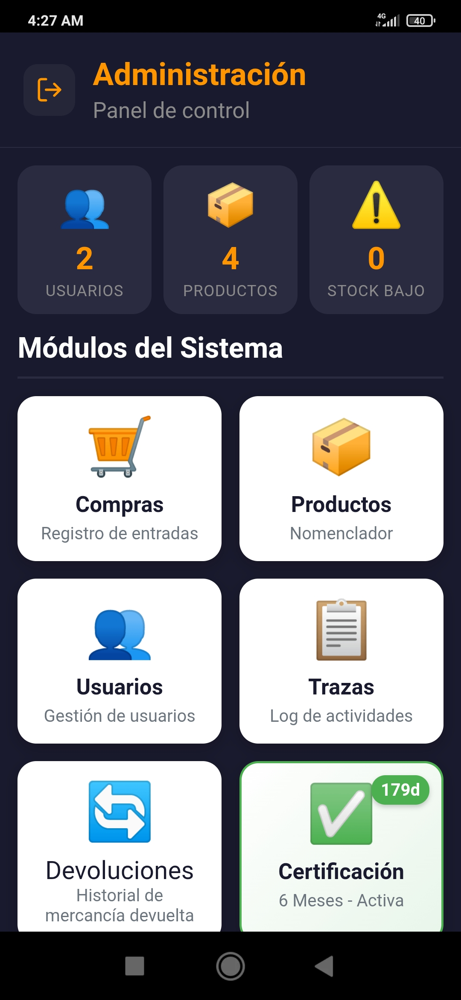
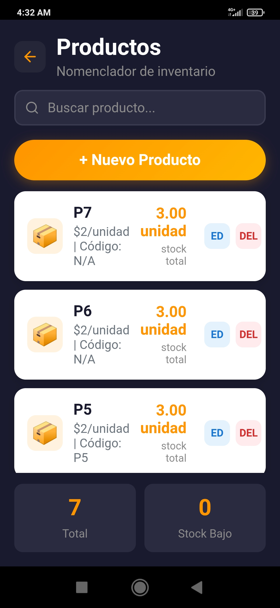
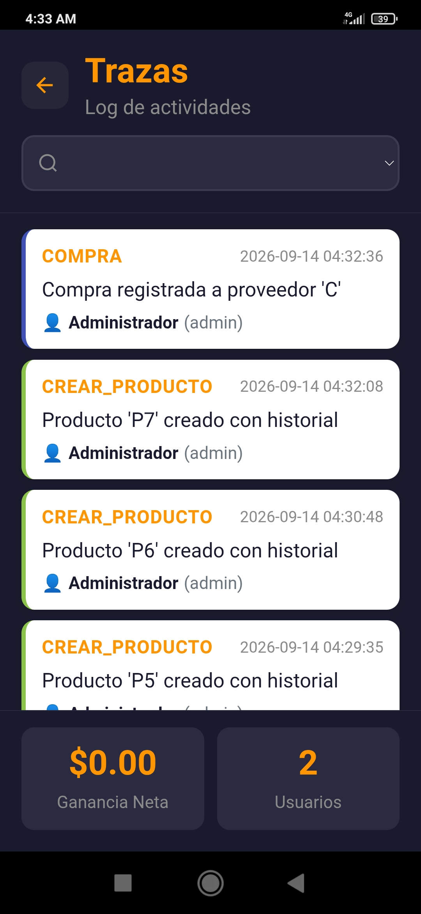
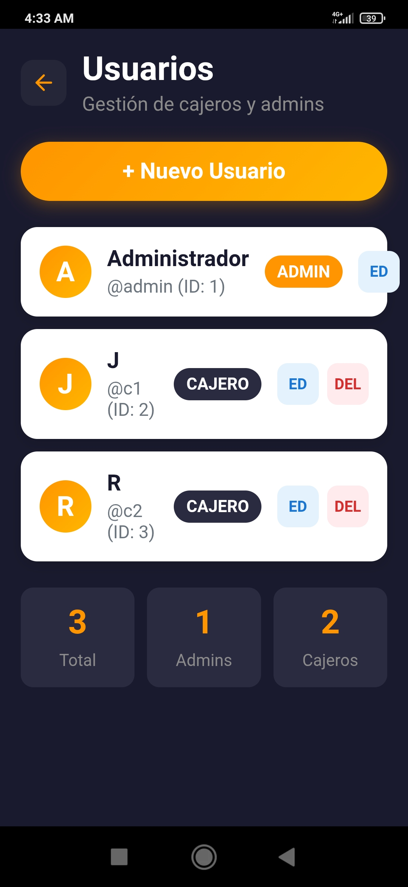

# 📱 gestorVT - Sistema POS y Gestión de Inventario Offline-First

**gestorVT** es una solución completa de Punto de Venta (POS) y gestión de inventarios diseñada para operar en entornos con conectividad inestable. Construida con una arquitectura **Offline-First**, garantiza que tu negocio nunca se detenga.

## 🚀 Características Principales

*   **Punto de Venta (POS) Rápido y Seguro:** Interfaz optimizada para agilizar las ventas diarias con cálculo de cambio automático y búsqueda rápida de productos.
*   **Gestión Total de Inventario:** Control de stock en tiempo real, alertas de stock bajo, nomenclador de productos y registro de compras.
*   **Control de Usuarios y Roles:** Sistema de permisos diferenciado (Administradores, Cajeros) con auditoría de acciones.
*   **Trazabilidad y Auditoría:** Registro detallado de todas las actividades (log de actividades, compras, ventas, devoluciones).
*   **Modo Offline:** Funciona sin conexión a internet, guardando los datos localmente para su posterior sincronización.
*   **Sistema de Licenciamiento:** Protección del software mediante certificación criptográfica (SHA-256) y bloqueo por hardware.

## 🛠️ Stack Tecnológico y Arquitectura

Este proyecto fue desarrollado aplicando buenas prácticas de ingeniería de software para garantizar escalabilidad, seguridad y rendimiento.

*   **Frontend (UI/UX):** Android (Java Nativo) + Vistas Híbridas (WebView con HTML5, CSS3 y JavaScript moderno).
*   **Base de Datos Local:** SQLite implementando el **Patrón DAO (Data Access Object)** para una separación limpia de la lógica de negocio y el acceso a datos.
*   **Backend (Sincronización):** PHP, MariaDB, Nginx.
*   **Seguridad:** Criptografía SHA-256 y sistema de bloqueo por hardware.

## 📸 Capturas de Pantalla

| Login y Bienvenida | Panel de Administración | Punto de Venta (POS) |
| :---: | :---: | :---: |
|  |  |  |

| Gestión de Productos | Trazas (Log de Actividades) | Gestión de Usuarios |
| :---: | :---: | :---: |
|  |  |  |

## 💡 El Reto Técnico
El principal desafío de este proyecto fue diseñar una arquitectura de base de datos que permitiera la sincronización bidireccional sin conflictos entre múltiples dispositivos (cajeros) que operan de forma local, asegurando la integridad de los datos y la lógica de negocio (como las devoluciones FIFO y el doble stock).

---
**Desarrollado por Raúl Ávila Hernández** | [LinkedIn](https://www.linkedin.com/in/raul-avila-h-dev)
